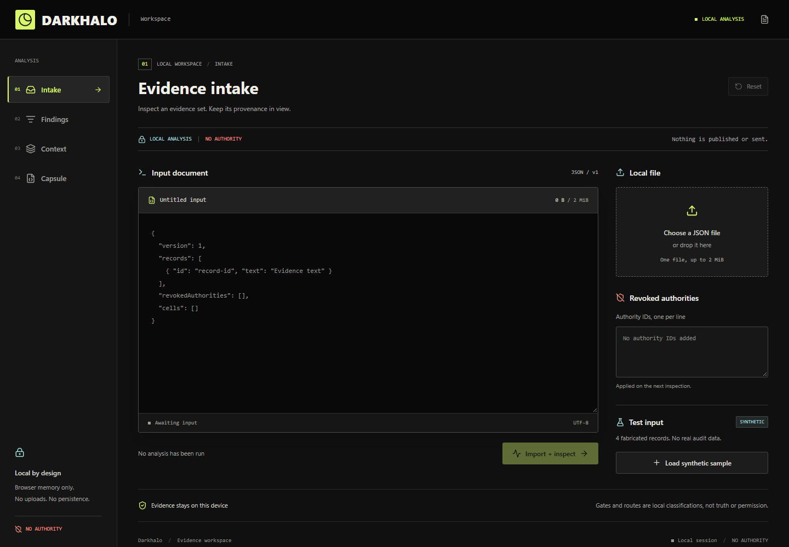

# DreamNet

**Reusable tools for AI work that survives the chat.**

I'm Brandon Ducar. I'm building toward a shared operating system for digital
and physical businesses. These public projects tackle practical pieces: keeping
useful context, bounding agent work, and making results inspectable.

[Explore the project directory](https://brandonducar.github.io/BrandonDucar/) |
[Ecosystem map](ECOSYSTEM.md) | [DreamNet](https://dreamnet.ink)

*Darkhalo's actual public interface. Its built-in sample is explicitly synthetic;
the screenshot is not a receipt for real-world work.*

## Start With A Problem

| I need to... | Try | What it provides |
| --- | --- | --- |
| Preserve and resume bounded agent work | [DreamLoops](https://github.com/BrandonDucar/dreamloops) | Versioned operating loops, capability Capsules, execution records |
| Inspect a repo before running it | [Cerberus](https://github.com/BrandonDucar/dreamnet-cerberus) | Offline static inspection and digest-bound findings, not a safety guarantee |
| Review agent-run context | [Darkhalo](https://darkhalo.dreamnet-intel.workers.dev) | Local-first inspection and review capsules, no automatic authority |
| Prepare source-linked knowledge | [Memory Weaver](https://github.com/BrandonDucar/memory-weaver) | Portable context with provenance |
| Hand work to someone else | [Warper Keeper](https://warper-keeper.dreamnet.ink) | Source-first Trapper context bundles |
| Package evidence for a build | [Proof Drop](https://proof-drop-zabal.pages.dev) | Local evidence-file hashing and exported receipts |

## Integrated Outside DreamNet

The independently operated [ZOL](https://github.com/bettercallzaal/zol) project
merged a [DreamLoops persistent-agent integration](https://github.com/bettercallzaal/zol/pull/19)
and a [Bonfire memory adapter](https://github.com/bettercallzaal/zol/pull/16).
The pull requests show the contributions. They are not a claim about ZOL's
current runtime, an endorsement, or DreamNet ownership.

## Explore Further

- [Public Core](https://github.com/BrandonDucar/Dreamnet): shared agent contracts.
- [ToolGym](https://github.com/BrandonDucar/toolgym): agent workouts; practice is not independent qualification.
- [LaunchCast](https://github.com/BrandonDucar/launchcast): repository-to-storyboard and local video rendering; uploads are not implemented.
- [Dreamnetiopi](https://github.com/BrandonDucar/dreamnetopi-hackday): merchant-operations rehearsal, not production telemetry.
- [All 32 public repositories](https://brandonducar.github.io/BrandonDucar/#projects): apps, libraries, research, prototypes, and attributed forks.

## Build With Us

Try one tool on a small, non-sensitive example. Report the version, what you
expected, what happened, and a reproducible fixture. Useful contributions include
interop tests, accessibility fixes, clear examples, and failure-case regression
tests. Follow each repository's license and contribution instructions.

DreamNet is early. Each repo has its own implementation boundaries and license.
A receipt is not proof that every claim inside it is true, and a capability is
not permission to act. Private credentials, customer data, and operating context
do not belong in public examples.
